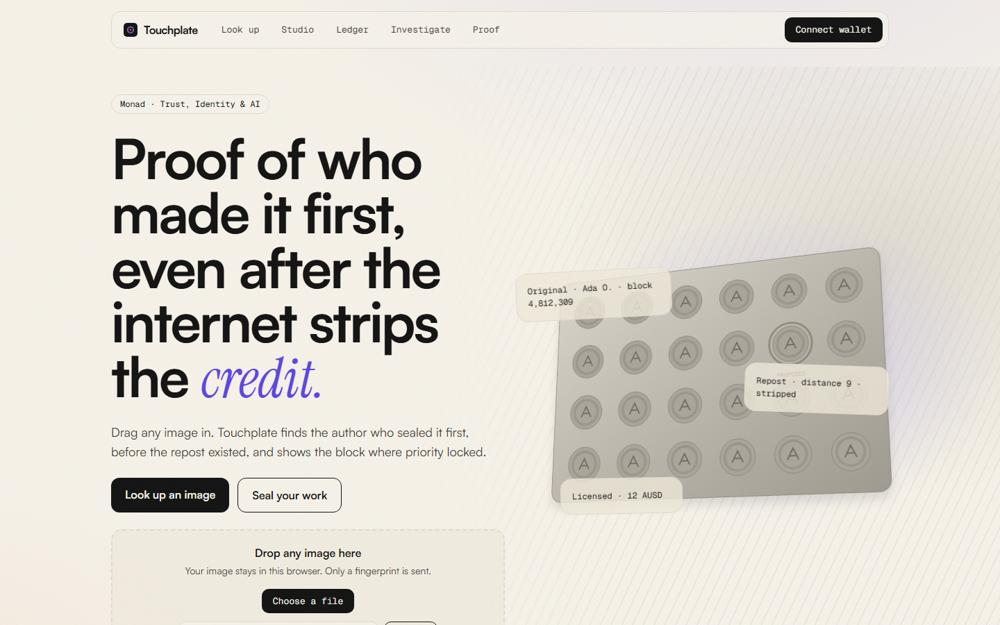
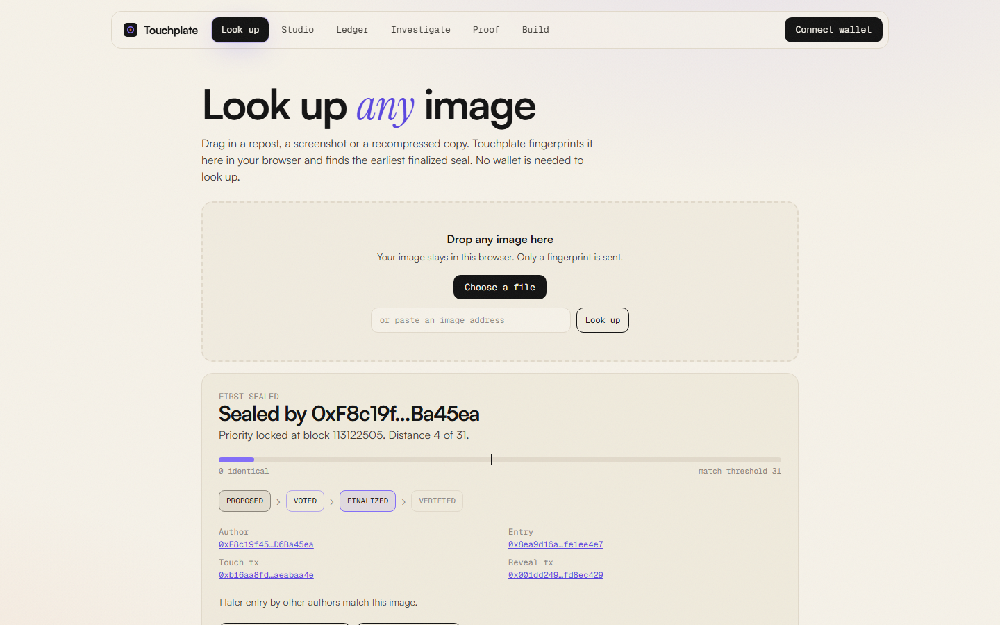
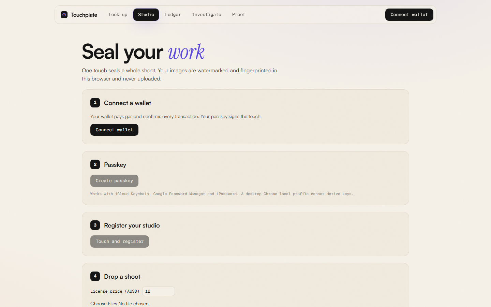
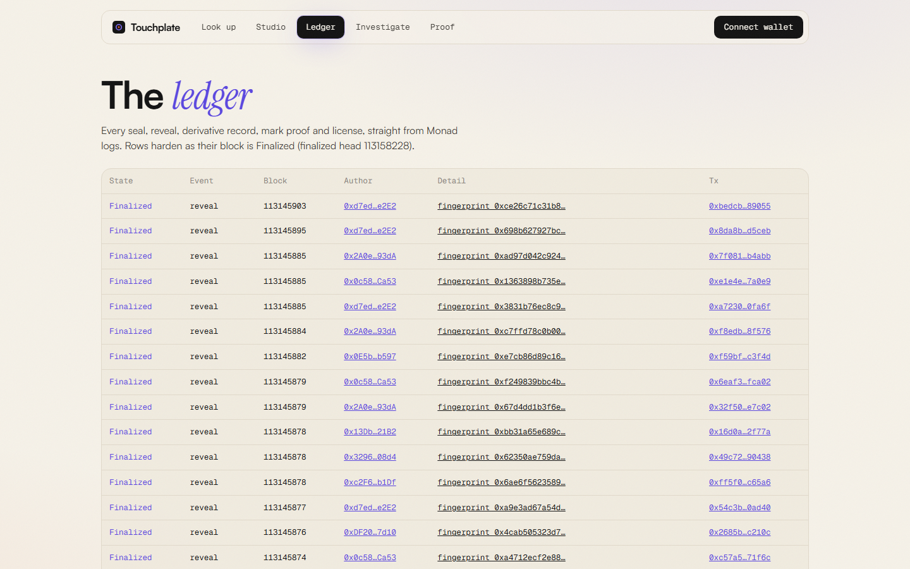
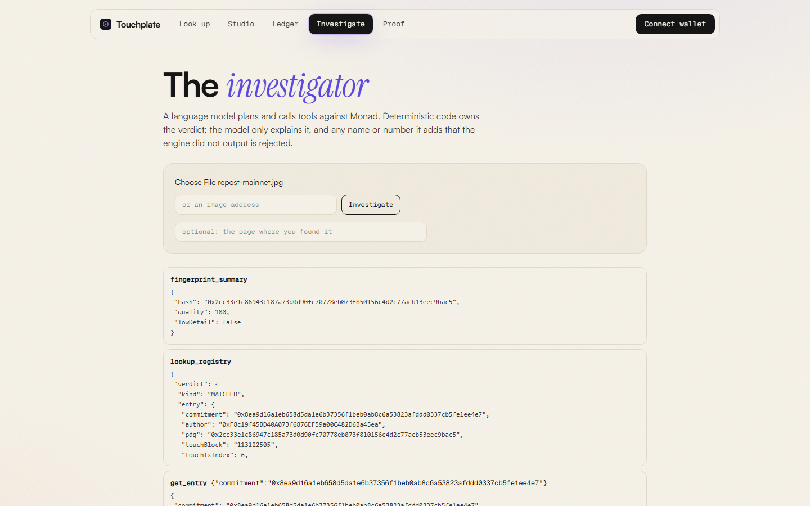
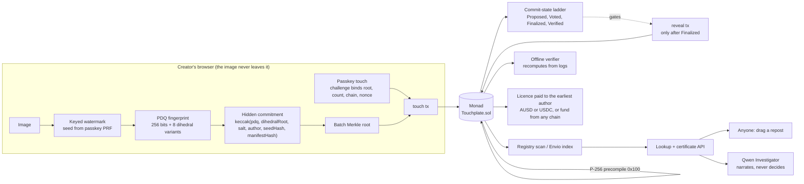
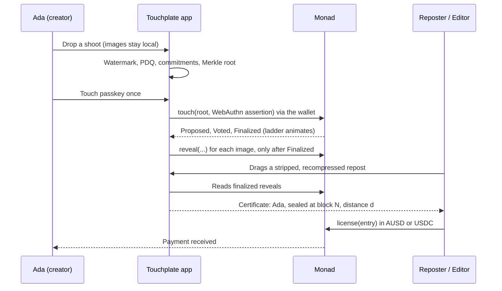
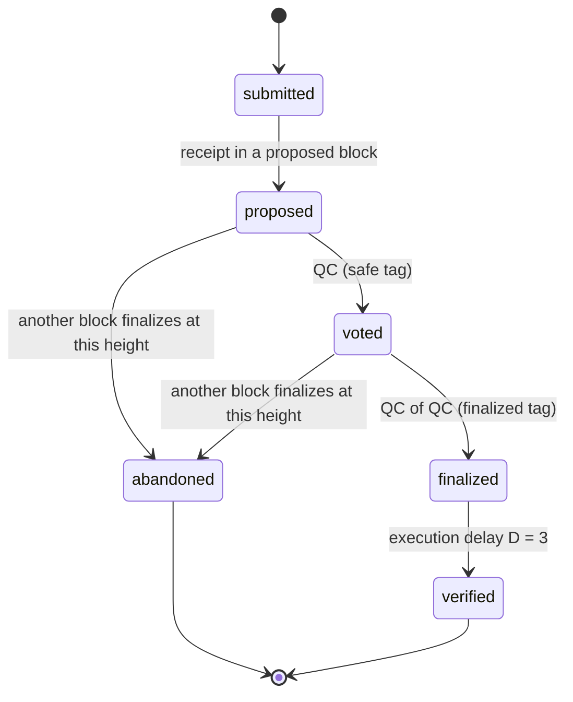
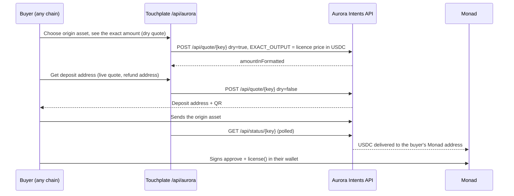

# Touchplate

[](https://touchplate.vercel.app)
[](https://monadscan.com/address/0x05648FAa32eeF566b97Cc8E0BAB1C15D7fBeeCF1)
[](#track-and-bounties)
[](#tests-and-evidence)
[](#tests-and-evidence)
[](LICENSE)

**Touchplate proves who made an image first, even after the internet strips the credit.**



---

## The brief

Ada Okafor (an illustrative persona) is a photojournalist in Lagos. Within an hour of her flood photographs going up, aggregator pages have reposted them. Every platform stripped the metadata and recompressed the pixels, so a file-hash registry matches nothing and Content Credentials are gone. The agency that wants to license the image calls the aggregator instead of Ada.

Touchplate changes the question from *"who has the file?"* to *"who sealed this picture first, on a ledger nobody controls?"* Ada touches her passkey once per shoot. The perceptual fingerprint that survives re-encoding is committed under a hidden Merkle root, verified on Monad by the P-256 precompile, and revealed only after that block is **Finalized**. Anyone can later drag a stripped repost into Touchplate and see Ada's seal, the block where priority locked, and a certificate that an offline verifier reproduces byte for byte.

> **Pixels decide the match. Monad's finalized order decides the priority. Neither our server nor our model can change either answer.**

## Links

| | |
|---|---|
| **Live app** | https://touchplate.vercel.app |
| **Contract (Monad mainnet)** | [`0x05648FAa32eeF566b97Cc8E0BAB1C15D7fBeeCF1`](https://monadscan.com/address/0x05648FAa32eeF566b97Cc8E0BAB1C15D7fBeeCF1) |
| **Proof page** | https://touchplate.vercel.app/proof |
| **Live ledger** | https://touchplate.vercel.app/ledger |
| **Verify yourself** | [`touchplate-verify`](#verify-without-trusting-us) (offline, no Touchplate server) |
| **Source** | https://github.com/0xkinno/touchplate |
| **Developer page** | https://touchplate.vercel.app/developers |
| **Technical demo (3 min)** | VIDEO_DEMO_URL_PLACEHOLDER |
| **Pitch (2 min)** | VIDEO_PITCH_URL_PLACEHOLDER |
| **Track and bounties** | Trust, Identity and AI Infrastructure. [Details below](#track-and-bounties) |

## Screens

| Look up: a stripped repost resolves to its first sealer | Studio: one touch, a live commit-state ladder |
|---|---|
|  |  |
| **Ledger: every seal and reveal, hardening in real time** | **Investigator: a model narrates, deterministic code decides** |
|  |  |

## The problem, measured

Every number below is generated from a results file in this repository. Transforms are platform-style simulations with `sharp`, not real platform uploads.

| After a strip, resize-to-1080 and JPEG q72 round trip | Survives |
|---|---|
| File-hash registry (SHA-256 of the bytes), what most on-chain notarisation does | **0%** |
| Embedded metadata credit (a C2PA-style manifest) | **0%** |
| Touchplate perceptual fingerprint | **100%** |

There is a second, subtler problem that is specific to Monad and is the reason this project is shaped the way it is.

## The discovery

On Monad "who was first" has **four** answers inside roughly a second and a half: Proposed, Voted, Finalized, Verified. There is no global mempool, and the speculative real-time feed publishes logs at *Proposed*, before the block is final. Only the Finalized order is a fact.

We measured it on mainnet and testnet before writing product code (`docs/DISCOVERY.md`):

- A block reaches Finalized a median of **564 ms** after it is first seen, and Verified at **1,472 ms** (286 complete ladders, 0.304 s block time).
- A registry that reveals the fingerprint inside the claiming transaction hands it to every `monadLogs` subscriber while the block is still only Proposed.
- So Touchplate **commits first and reveals only after Finalized**. Priority becomes a fact that no server, model or copycat can change.

## How it works

```
 CREATOR                        MONAD                                   ANYONE
 -------                        -----                                   ------
 drop 12 photos
 embed mark, hash (local)
 build commitments + root
 touch passkey  --touch(root, assertion)-->  P256 verify -> Touched
                                              Proposed -> Voted -> Finalized
 wait for Finalized  <------------------------------┘
 reveal(proof, pdq, salt)  --------------->  Revealed (priority = touch block)
                                              Verified (D = 3 blocks later)
                                                                    drag a repost
                                                     lookup(pdq') <-- hash locally
                                              earliest finalized match --> certificate
                                              recordPriority(a, b) --> on-chain derivative
                                              license(a) AUSD or USDC --> paid to the author
```







### The mechanism in four moves

1. **Mark.** A secret keyed watermark (8x8 DCT mid-band, ChaCha20 pattern, per-block masking, calibrated to 40.6 dB PSNR) is derived from the passkey's PRF output. The fingerprint is public and proves *similarity*; the mark is secret and proves *authorship on demand*.
2. **Fingerprint.** PDQ (256 bits, quality score, 8 dihedral variants). Our TypeScript port matches the Python reference exactly on 49 of 50 images; the exception is a degenerate gradient where the reference implementations disagree with each other.
3. **Touch.** One WebAuthn assertion over `keccak(domain, chainId, sender, root, count, nonce)` is verified on chain through the P-256 precompile. A replayed assertion reverts (drill D7).
4. **Lock.** The client refuses to reveal until the touch block is Finalized (invariant I3). The contract accepts the reveal only from the same author, for a leaf in a touched root, inside a window of about seven days.

## What we found that was not obvious

| Finding | Evidence | Consequence |
|---|---|---|
| `Verified` is a native `commitState`, with `D = 3` | `spikes/s1-ladder-blocks.json` | No `+3` derivation; the ladder reads the field |
| Gas is charged on the **declared limit** | `spikes/s2-gas.json`: 45,020 vs 90,040 limit paid exactly 2x for identical execution | Every transaction carries a tight explicit limit (I10) |
| Cold storage is priced per 128-slot **page** (MIP-8) | `spikes/s9-storage.json`: 82k vs 133k vs 256k gas for the same entry | Entry packed into five slots in one page |
| The precompile verifies browser-made WebAuthn assertions; high-s is rejected | `spikes/s4-sim.json` and on-chain txs | Client low-s normalises every assertion |
| One PDQ canonical hash is **not** stable under rotation | upstream README, confirmed in `spikes/s5` | The earlier author commits a Merkle root over all 8 dihedral variants |
| PDQ crop tolerance is only about 2 to 3% per axis | `spikes/s5-crop.json` | Large crops declared out of scope, reported honestly |
| The public RPC caps `eth_getLogs` at 100 blocks | measured on 12 endpoints | Chunked scanner with a build-time checkpoint, not a naive full scan |

## Judge it in two minutes

1. Open https://touchplate.vercel.app/lookup (no wallet needed) and drop any recompressed or resized copy of an image listed on the [ledger](https://touchplate.vercel.app/ledger), or the provided sample [`docs/evidence/sample-repost.jpg`](docs/evidence/sample-repost.jpg) (sealed on testnet). You get the author, the block where priority locked, the distance and a downloadable certificate.
2. Open the **entry page** from the verdict and follow the touch and reveal links to the explorer.
3. Run the offline verifier on the same file (command below) and compare `certSha256`.
4. Open [/proof](https://touchplate.vercel.app/proof) for the generated numbers and the break campaign.

## Build on Touchplate

Touchplate is a provenance primitive. Any app can seal, look up and verify without asking us. The full page, with the contract and event tables, is at [/developers](https://touchplate.vercel.app/developers).

1. **Fingerprint in the browser.** `pdqFromRgba(rgba, width, height)` from `@touchplate/core` returns the 256-bit hash, a quality score and 8 dihedral variants. Only those leave the page.
2. **Look up by fingerprint.** `POST /api/lookup` with `{ pdq: { hash, quality, dihedral } }` returns `{ certificate, seeds, finalizedBlock, entries }`. Image bytes are never accepted (invariant I9).
3. **Verify without us.** `touchplate-verify --image suspect.jpg --rpc https://rpc.monad.xyz --contract 0x05648FAa32eeF566b97Cc8E0BAB1C15D7fBeeCF1 --from-block 113077560` recomputes the verdict from chain logs.

`@touchplate/core` is a workspace package, publishing next.

## The numbers

<!-- NUMBERS:START -->
Measured on COCO val2017 first 200 files (platform-style simulations with sharp, not real platform uploads).

| Measure | Result |
|---|---|
| Platform round trip (strip, resize 1080, JPEG 72): fingerprint recall | 100% |
| Same round trip: file-hash match | 0% |
| Horizontal flip recall (with / without dihedral variants) | 99.5% / 0.5% |
| False matches among 19900 distractor pairs | 0 |
| Crop 1% per axis: fingerprint recall | 98% |
| Crop 2% per axis: fingerprint recall | 95% |
| Crop 4% per axis: fingerprint recall | 17% |
| Crop 6% per axis: fingerprint recall | 0% |
| Crop 10% per axis: fingerprint recall | 0% |
| Crop 20% per axis: fingerprint recall | 0% |
| Proposed to Finalized (p50 / p90, 286 blocks) | 564 ms / 628 ms |
| Proposed to Verified (p50) | 1472 ms |
| P-256 verify, precompile path / Solidity fallback | 43256 / 256353 gas |
| Entry write, packed / skeleton / scattered | 81592 / 133468 / 256453 gas |
| Watermark PSNR (min) / z after transforms (min) | 40.6 dB / 12.74 |

Benchmark on Monad mainnet: 300 images registered through the real flow, 50 thief copies registered later, 1000 distractors, 19 transforms (platform-style simulations with sharp, not real platform uploads).

| Transform | File hash | Metadata | Fingerprint only | Touchplate | Random threshold (control) | Shuffled order (control) |
|---|---|---|---|---|---|---|
| JPEG q90 | 0% | 0% | 98.3% | 100% | 40% | 92.7% |
| JPEG q70 | 0% | 0% | 97% | 100% | 38% | 92% |
| JPEG q50 | 0% | 0% | 97.3% | 100% | 39.7% | 92.3% |
| WebP q75 | 0% | 0% | 98.3% | 100% | 37.7% | 92.3% |
| resize 1080 long edge | 0% | 0% | 98.3% | 100% | 39.3% | 91.7% |
| resize 640 long edge | 0% | 0% | 100% | 100% | 44.3% | 93.7% |
| centre crop 5% | 0% | 0% | 7% | 7% | 22% | 6.3% |
| centre crop 10% | 0% | 0% | 0.3% | 0.3% | 6.3% | 0.3% |
| centre crop 20% | 0% | 0% | 0% | 0% | 1% | 0% |
| brightness +15% | 0% | 0% | 96.3% | 100% | 40.7% | 91.7% |
| brightness -15% | 0% | 0% | 99.7% | 100% | 48.3% | 91% |
| contrast +15% | 0% | 0% | 97.7% | 100% | 36.7% | 91.7% |
| contrast -15% | 0% | 0% | 99% | 100% | 35.3% | 89% |
| 2% border | 0% | 0% | 8.3% | 8.3% | 16% | 8.3% |
| text overlay | 0% | 0% | 96.3% | 97.7% | 39% | 91% |
| screenshot frame | 0% | 0% | 0% | 0% | 0.3% | 0% |
| horizontal flip | 0% | 0% | 97% | 99.3% | 36.7% | 89.7% |
| metadata strip | 0% | 0% | 98.7% | 100% | 38.7% | 91.3% |
| platform round trip | 0% | 0% | 94.7% | 100% | 40% | 94.7% |

On the 950 contested queries (50 images that a thief re-registered later, across all 19 transforms, including the out-of-scope crops, border and frame where every arm fails): fingerprint only 65.1%, Touchplate 74%, shuffled order 38.3%.
False attribution on 1000 never-registered distractors at threshold 31: 0 (0%).
Watermark z after JPEG q70: marked median 58.4 (min 27.65), unmarked max 2.62.
Lookup latency, brute force over 8 dihedral variants (synthetic registry sizes): 1000 entries 0.92 ms, 10000 entries 9.06 ms, 100000 entries 58.35 ms.
<!-- NUMBERS:END -->

## How Monad decides, each with a measured number

| Monad property | What Touchplate does with it | Measured |
|---|---|---|
| Four commit states, native on `monadNewHeads` | The ladder gates reveal and labels every certificate | Proposed to Finalized p50 564 ms, p90 628 ms |
| No global mempool; logs publish at Proposed | Commit before reveal | Naive claim leaked on the Proposed feed 3.8 s after submission (D5) |
| P-256 precompile at `0x100` | Passkey touch verified on chain, no smart wallet | about 43k gas per call vs 256k Solidity fallback |
| Gas charged on the limit | Tight explicit limits from a committed profile | 2x limit paid exactly 2x |
| Storage pages (MIP-8) | One entry, one page | 82k gas per entry vs 256k scattered |

## Invariants

| ID | Invariant | Checked by |
|---|---|---|
| I1 | A Finalized entry's priority never changes | Foundry invariant test, offline verifier |
| I2 | Nothing is labelled "Priority locked" before its touch block is Finalized | ladder logic, UI |
| I3 | No reveal is broadcast before the touch block is Finalized | Studio gate, D5 |
| I4 | A reveal proves membership in a touched root by the same author inside the window | contract tests |
| I5 | Every touch is a fresh assertion bound to root, count, chain and nonce | contract tests, D7 |
| I6 | Attribution goes to the earliest finalized matching entry | verdict tests, D3, D4 |
| I7 | The server verdict equals the offline verifier verdict | D8 |
| I8 | The model may not name any author, block or tx the engine did not output | validator, D9 |
| I9 | Images never leave the browser; the server receives fingerprints only | Playwright network assertion |
| I10 | Every tx declares an explicit gas limit from the profile | transaction hook |
| I11 | Licences never pay a derivative entry | Foundry invariant test, D3 |
| I12 | An entry in an abandoned proposal is never shown as recorded | ladder test |

## Break campaign

Ten drills, each a script (`drills/src/dN-*.ts`) writing `docs/drills/Dn.md` and `.json` with transaction links. All ran against Monad mainnet.

| Drill | Attack or fault | Recorded outcome | Report |
|---|---|---|---|
| D1 Strip and squeeze | Platform round trip on all registered images | File hash 0/8, metadata 0/8, Touchplate recovered the author 8/8 | [D1](docs/drills/D1.md) |
| D2 Crop and frame | Crops, border, text, screenshot frame, flip | Flip 8/8, text overlay 7/8, 2% border 1/8, **crops and phone frame 0/8** (published as measured) | [D2](docs/drills/D2.md) |
| D3 Late thief | A second wallet registers a stolen copy | Verdict names the original; `recordPriority` marks the thief derivative; thief `license()` reverts | [D3](docs/drills/D3.md) |
| D4 Same-image race | Adjacent blocks, then the same block | Earlier finalized touch wins; same-block case reported **CONTESTED** with tx indices 12 and 11 | [D4](docs/drills/D4.md) |
| D5 Copycat | A bot on the speculative feed vs a naive registry | Naive claim exposed the fingerprint pre-finality; Touchplate exposed only a root; bot reveal reverted | [D5](docs/drills/D5.md) |
| D6 Collision forgery | 4,000-step black-box hill climb | Best distance 62 vs threshold 31: no record; mark z -0.93, never AUTHORED | [D6](docs/drills/D6.md) |
| D7 Replayed touch | Old assertion; assertion for another root | Both revert on chain | [D7](docs/drills/D7.md) |
| D8 Lying server | Forged verdict, with and without re-hash | Hash mismatch and verdict mismatch reported separately | [D8](docs/drills/D8.md) |
| D9 Hostile prompt | Injected metadata and a decoy page | Engine verdict unchanged; model did not name the attacker | [D9](docs/drills/D9.md) |
| D10 Burst | 20 studios x 10 images, concurrent | 200/200 on chain, 0 lost, 0 duplicated, 0 reordered | [D10](docs/drills/D10.md) |

Two results are deliberately uncomfortable and are left in: D2 (crops) and D5 (on a healthy chain the copier did not overtake an already-proposed block; the exposure is the fingerprint itself plus the abandoned-block and same-block cases, which a hidden commitment removes).

## Verify without trusting us

```bash
# image mode: recompute fingerprint, verdict, finality and (if proven) the mark z from chain logs
pnpm --filter touchplate-verify start -- --image ./suspect.jpg \
  --rpc https://rpc.monad.xyz --contract 0x05648FAa32eeF566b97Cc8E0BAB1C15D7fBeeCF1 --from-block 113077560

# certificate mode: reproduces certSha256 and checks the chain facts it cites
pnpm --filter touchplate-verify start -- --certificate ./cert.json \
  --rpc https://rpc.monad.xyz --contract 0x05648FAa32eeF566b97Cc8E0BAB1C15D7fBeeCF1
```

It prints PASS or FAIL for every check and never contacts a Touchplate server.

## Integrations

| Integration | Role | State |
|---|---|---|
| **Mera** (passkey PRF) | One passkey yields three unrelated key families: the Monad account (BIP-44), an Ed25519 studio key that signs manifests, and a secret watermark root. The P-256 public key is captured in the same ceremony through Mera's injectable WebAuthn client | implemented; passkey runs used a virtual authenticator, real-device runs pending |
| **Qwen 3.8 Max** (Alibaba Model Studio) | The Provenance Investigator plans and calls eight tools; a validator rejects any address, hash or block the engine did not output | tool-call round trip verified; D9 passed against production |
| **Envio** | HyperIndex config, schema and handlers in `indexer/`; HyperSync is the verifier fast path | config committed; hosted deployment and token pending |
| **Aurora Intents** | "License from any chain": dry quote to USDC on Monad, deposit address and QR, status polling, then the buyer signs `license()` | quote, tokens and status routes verified against Aurora's API; the one real cross-chain payment is pending 0xkinno |
| **AUSD and USDC** | Licence tokens (immutable allowlist of two) | live on mainnet |

## Aurora Intents: license from any chain

A licence is paid in USDC (or AUSD) on Monad. A buyer holding another asset on another chain does not have to bridge by hand.



What was verified: the key authenticates against `https://intents-api.aurora.dev` (203 supported assets), Monad USDC settles on chain 143 (`0x754704Bc…B603`) and AUSD does not, which is why the contract carries an immutable allowlist of AUSD and USDC. The final step, `license()`, is always a normal wallet transaction.

The one live cross-chain payment must be sent by the licensee from their own wallet; it is the open item in [`EVIDENCE.md`](EVIDENCE.md).

## What is enforced where

| Enforced on chain | Computed off chain (reproducible by the verifier) | Not covered |
|---|---|---|
| Passkey assertion bound to root, count, chain, nonce | PDQ fingerprint and dihedral variants | Large crops, heavy reframing |
| Reveal membership, author and window | Watermark embed and z-score | Authorship of a picture before it was ever sealed |
| Priority ordering by touch block | Verdict and certificate hash | Same-block ties (reported as CONTESTED, never decided) |
| Derivative marking and licence payment | Ladder timing | Real platform behaviour on real uploads (simulated here) |

Honest boundaries are also in [`docs/LIMITATIONS.md`](docs/LIMITATIONS.md).

## Deployed contracts

| Network | Contract | Address | Block | Deploy tx |
|---|---|---|---|---|
| Monad mainnet (143) | **Touchplate** | [`0x05648FAa32eeF566b97Cc8E0BAB1C15D7fBeeCF1`](https://monadscan.com/address/0x05648FAa32eeF566b97Cc8E0BAB1C15D7fBeeCF1) | 113077560 | [`0x6520…ad1b`](https://monadscan.com/tx/0x65203152bfc9a12b64aeb4fcf708c87716480519b1e5172a8cc554daf462ad1b) |
| Monad testnet (10143) | Touchplate | [`0x13a5941833F568Cb80d4958ED22B4B9d44a87930`](https://testnet.monadexplorer.com/address/0x13a5941833F568Cb80d4958ED22B4B9d44a87930) | 70705967 | [`0x748d…1bad`](https://testnet.monadexplorer.com/tx/0x748d88345cd7b0052f9614e2a4f0e67f6e01ffa252b32b8e9e4b0bfd3e111bad) |
| Monad testnet (10143) | P256Probe (Phase 0 spike) | `0xbae6c16d54a76ae3539f7fdcd2617db236f9244a` | | [`0x002f…00dd`](https://testnet.monadexplorer.com/tx/0x002f02c73d7ed6e53f01aea96af79bde432500f7057829c8f973ec696e94dcdd) |
| Monad mainnet (143) | NaiveRegistry (drill D5 only) | `0xc2814c103eb45c9654927c775586573bc5d7a461` | | [`0x607d…85f9`](https://monadscan.com/tx/0x607d5e0b6a141a7444f45321a23175996e6ef75ea5358dce20b61e83520b85f9) |

| Token | Mainnet | Testnet |
|---|---|---|
| AUSD (6 decimals) | `0x00000000eFE302BEAA2b3e6e1b18d08D69a9012a` | `0xa9012a055bd4e0eDfF8Ce09f960291C09D5322dC` |
| USDC (6 decimals) | `0x754704Bc059F8C67012fEd69BC8A327a5aafb603` | `0x534b2f3A21130d7a60830c2Df862319e593943A3` |

The contract has no admin over entries or priority. The only owner-controlled value is the licence fee recipient, set at construction, with a fee hard-capped at 3% (currently 1%).

## Contract design

| Function | Behaviour |
|---|---|
| `registerStudio(qx, qy, ed25519Pub, auth)` | Binds a passkey and studio key to an address; challenge covers domain, chain, sender and keys |
| `touch(root, count, auth)` | Fresh assertion over root, count, chain, nonce; increments a per-author nonce |
| `reveal(root, proof, pdq, dihedralRoot, salt, markSeedHash, manifestHash, price)` | Same author, inside the window, valid Merkle proof, not yet revealed |
| `recordPriority(earlier, later, variant, proof)` | Permissionless; strictly earlier touch block, different author, committed variant within distance 31 |
| `proveMark(commitment, suspectSha256, seed, zMilli, uri)` | Author publishes the seed for one image; anyone recomputes z |
| `license(commitment, token, maxPrice)` | Pays the author (and the capped fee); reverts for derivatives |

An entry is stored in five slots inside one storage page. `Hamming.sol` uses SWAR popcount with masks generated by `scripts/gen-masks.ts`.

## Tests and evidence

| Suite | Result |
|---|---|
| Foundry: unit, fuzz (Hamming vs naive), invariants (touch block immutable, licence never pays a derivative, derivative implies an earlier match by another author), real WebAuthn fixture | 27 passing |
| `@touchplate/core` (vitest, includes on-chain `commitmentOf` parity against the deployed contract) | 18 passing |
| Playwright end to end on the live site: connect modal, passkey, register, watermark, touch to Finalized, reveal, stripped repost attributed, no image bytes in requests | passing on https://touchplate.vercel.app |
| Authorship check (history contains only 0xkinno, no trailers, no tracked secrets) | enforced by hook and CI |

Every on-chain action in the UI opens the connected wallet and sends a real signed transaction; the end-to-end test counts the `eth_sendTransaction` requests to prove it.

## Local setup

```bash
pnpm install
(cd contracts && forge install foundry-rs/forge-std --no-git && forge test)
(cd packages/core && npx vitest run)
cp .env.example .env.local        # fill the values listed in HANDOFF.md
cd apps/web && npx next dev -p 3100
```

Operating notes for the next maintainer, including every environment variable, are in [`HANDOFF.md`](HANDOFF.md).

## Who it is for, and why they keep using it

Working photographers, illustrators and photojournalists who publish online, and the editors and fact-checkers who must attribute images. Creators keep using it because a seal costs a few cents of gas and produces a licensing channel; editors keep using it because the certificate is checkable without trusting anyone.

**Revenue.** A capped protocol fee on licences (1% today, 3% ceiling in code), studio plans for agencies, and a newsroom API for bulk lookup and certificate delivery.

## Who adopts this primitive, and why not roll your own

| Adopter | Why they need it | What they call |
|---|---|---|
| Image generators and creative AI tools | Seal output at the moment of creation, so provenance survives every repost | `touch` and `reveal` |
| Newsrooms, wire desks and fact-checkers | Credit the right person on a stripped copy, with a certificate they can re-verify | `/api/lookup`, `touchplate-verify` |
| Licensing and stock marketplaces | Pay the earliest finalized author, never a derivative | `license` |

Rolling your own means solving Monad's four commit states, commit before reveal against a speculative log feed, on-chain P-256 passkey verification with low-s normalisation, re-encoding-robust fingerprints with dihedral variants, and an offline verifier. Each of those is measured in [docs/DISCOVERY.md](docs/DISCOVERY.md).

## Traction and path forward

What is true today: live on Monad mainnet, 300 images sealed through the real flow, ten drills run on mainnet with transaction links, and the ledger count is read from chain. No outside team has integrated yet, and nothing here claims otherwise.

The plan: publish `@touchplate/core`, ship a browser extension that checks images in place, build a newsroom CMS plugin, and reach out to image generators, newsrooms and licensing marketplaces by name. Any outside developer who calls `/api/lookup` or `touchplate-verify` will be recorded in [EVIDENCE.md](EVIDENCE.md) with their permission.

## What is new

All code in this repository was written during Monad Metropolis; the first commit is dated 2026-10-13.

## Roadmap

A browser extension that checks images in place, a newsroom CMS plugin, video keyframes, and C2PA manifest export that embeds the Touchplate certificate.

## Track and bounties

**Primary track: Trust, Identity and AI Infrastructure.** Touchplate is a measured answer to the track's own example, provenance for generated media that survives re-encoding.

| Bounty | How Touchplate qualifies |
|---|---|
| Mera: One Passkey, Many Keys | PRF output derives the Monad account, an Ed25519 studio key and a watermark root; two of the three are not wallet uses |
| Best Mera-Powered UX | The passkey is the identity layer: no seed phrase, one touch per shoot |
| Best Builds with Qwen 3.8 Max | The Investigator: Qwen plans and calls tools, deterministic code owns the verdict, a validator enforces it (D9) |
| Best Use of Envio | HyperIndex schema and handlers; HyperSync as the verifier fast path |
| Aurora Intents: Bring Any-Chain Liquidity to Monad | "License from any chain" funds a licence from another chain into USDC on Monad |

### The five track criteria

| Criterion | Proof |
|---|---|
| Technical Execution | [Passkey assertions verified on chain by the P-256 precompile](docs/DISCOVERY.md), [ten mainnet drills](docs/drills/) |
| Design & Craft (developer experience) | [/developers](https://touchplate.vercel.app/developers), [`touchplate-verify`](#verify-without-trusting-us) |
| Originality & Track Insight | [Commit before reveal, keyed to Monad finality](#the-discovery) |
| Founder & Market Readiness | [Adopters and the fee model](#who-adopts-this-primitive-and-why-not-roll-your-own) |
| Traction & Path Forward | [Live ledger](https://touchplate.vercel.app/ledger), [EVIDENCE.md](EVIDENCE.md) |

## Documentation

[`docs/DISCOVERY.md`](docs/DISCOVERY.md) · [`docs/LIMITATIONS.md`](docs/LIMITATIONS.md) · [`docs/ARCHITECTURE.md`](docs/ARCHITECTURE.md) · [`docs/INVARIANTS.md`](docs/INVARIANTS.md) · [`docs/PROOF.md`](docs/PROOF.md) · [`EVIDENCE.md`](EVIDENCE.md) · [`AI_USAGE.md`](AI_USAGE.md) · [`MILESTONES.md`](MILESTONES.md) · [`HANDOFF.md`](HANDOFF.md)

## License

MIT. Authored by 0xkinno.
