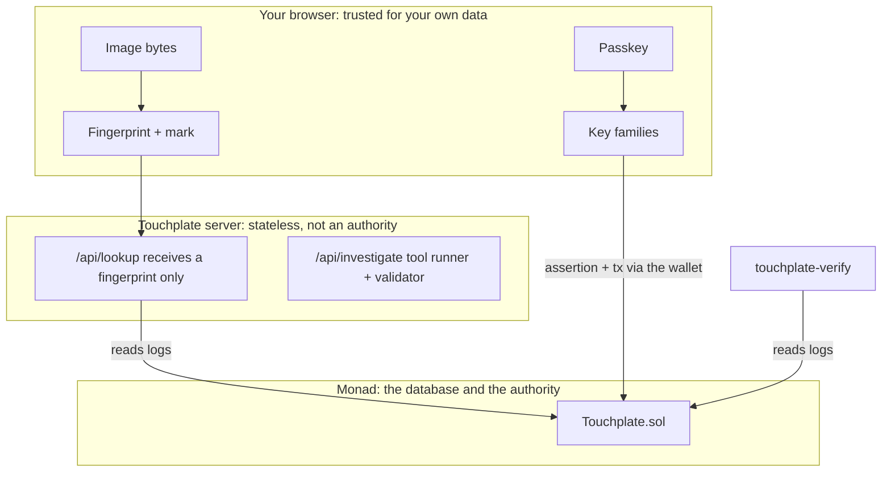

# ARCHITECTURE

## Components

| Component | Path | Responsibility |
|---|---|---|
| Contract | `contracts/src/Touchplate.sol`, `Hamming.sol` | Passkey-verified sealing, finality-gated reveal, priority records, licensing. No admin over entries |
| Core | `packages/core` | Browser and Node safe: PDQ, watermark, commitments, key families, manifest, WebAuthn helpers, ladder tracker, log scanner, verdict engine, certificate, gas profile |
| Web app | `apps/web` | Next.js 15. Landing, Studio, Lookup, Ledger, Investigator, Proof, entry pages and the API routes |
| Verifier | `verifier` | `touchplate-verify`: recomputes everything from chain logs and the image |
| Drills | `drills` | Scripts that attack the system on mainnet and write evidence |
| Bench | `bench` | 300 registered images, 1,000 distractors, 19 transforms, four arms and controls |
| Indexer | `indexer` | Envio HyperIndex config, schema and handlers (a cache, never an authority) |

## Trust boundaries

The server holds no keys and signs nothing for users. Every state change is a transaction sent by the user's wallet.

## Data flow

1. The browser decodes an image, embeds the keyed watermark, publishes a JPEG, fingerprints the published bytes, builds a commitment `keccak(DOMAIN_ENTRY, chainId, author, pdq, dihedralRoot, salt, markSeedHash, manifestHash)` and a Merkle batch.
2. `touch(root, count, assertion)` seals the batch. The assertion is a WebAuthn signature over `keccak(DOMAIN_TOUCH, chainId, sender, root, count, nonce)` verified by the P-256 precompile.
3. The ladder tracker waits for the touch block to be Finalized (native `commitState`, block-hash checked), then `reveal` runs per image.
4. Lookup hashes the suspect locally, the server compares against finalized entries across the 8 dihedral variants, and `decide()` returns the verdict; `attest()` assembles the certificate, which the verifier reproduces.

## Storage layout

An `Entry` is five slots in one page (MIP-8 prices cold storage per 128-slot page): `pdq`, `dihedralRoot`, `markSeedHash`, `author + licensePrice`, `touchBlock + revealBlock + derivative`. `root` and `manifestHash` are emitted in events rather than stored.

## Why a registry checkpoint

The public RPC caps `eth_getLogs` at 100 blocks. The web app embeds a build-time snapshot of the registry and resumes from its last scanned block in time-budgeted slices. The indexer is the production answer; the verifier works with neither.
